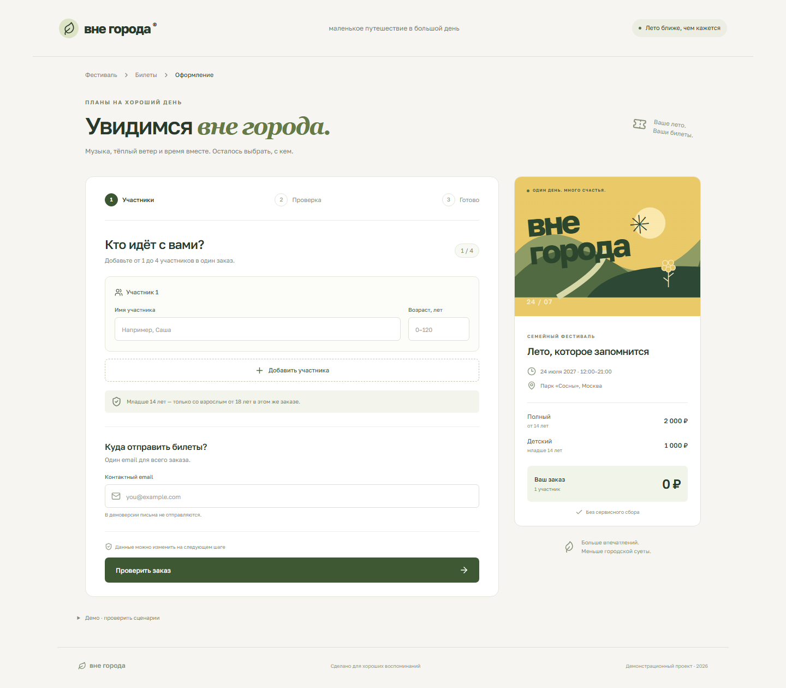

# Вне города · Sqoch Test 01

Рабочий интерфейс покупки билетов на вымышленный семейный фестиваль: от данных участников до результата оформления. React + TypeScript, Vite, моковый API без сервера.



## Запуск

Нужен **Node.js 22.12+** или Node.js 24, npm. Никаких ключей и переменных окружения для приложения нет.

```sh
git clone https://github.com/Sonti22/sqoch-tickets.git
cd sqoch-tickets
npm ci
npm run dev
```

Откройте адрес из терминала, обычно `http://127.0.0.1:5173`. Для production-сборки: `npm run build`, затем `npm run preview`. Каталог `dist/` можно разместить на статическом хостинге. Приложение, иллюстрация и шрифт включены в сборку; внешних сервисов приложение не вызывает.

## Что проверить

1. Введите имя, возраст и email. Добавьте второго участника: например, взрослого 35 лет и ребёнка 8 лет. Итог — **3 000 ₽**.
2. Нажмите **«Проверить заказ»**. Состав, email и сумма видны перед подтверждением. **«Изменить данные»** возвращает заполненную форму; цены пересчитываются.
3. **«Подтвердить заказ»** показывает загрузку, затем номер заказа и скачивание демо-билетов в `.txt`.
4. Для отказа раскройте **«Демо · проверить сценарии»** под формой, выберите **«Места закончатся перед подтверждением»** и оформите заказ. Отказ происходит после финальной проверки, данные сохраняются. **«Повторить с доступными местами»** или смена сценария восстанавливают моковое наличие.
5. Попробуйте ребёнка без взрослого, возраст 17 лет у сопровождающего, пустые поля, неверный email, дробный возраст, добавление пятого участника. Проверьте на ширине **360 px**.

## Правила и принятые решения

| Условие | Поведение |
| --- | --- |
| Участников в заказе | От 1 до 4; последнего удалить нельзя |
| Возраст младше 14 лет | Детский билет, 1 000 ₽; в этом же заказе нужен участник от 18 лет |
| Возраст от 14 лет | Полный билет, 2 000 ₽ |
| Возраст | Целые полные годы от 0 до 120, включая младенцев |
| Имя и email | Обязательны, пробелы по краям удаляются при подтверждении |
| Контакты | Один email на заказ |
| Места | Проверяются в момент подтверждения, при вводе не резервируются |

**Допущение:** слово «ребёнок» трактуется по границе детского тарифа: младше 14 лет. Участники 14–17 лет платят полный тариф и могут идти без сопровождающего. Если сопровождение нужно для всех младше 18 лет, это отдельное бизнес-правило; тарифная граница при этом не меняется.

Данные, место и дата фестиваля вымышлены. Платёжного провайдера и реальной отправки email нет. Демо-билет прямо отмечен как недействительный для входа. Вводимые данные остаются в памяти вкладки; после перезагрузки форма и заказы сбрасываются. Инвентарь и защита от повторного запроса действуют только внутри экземпляра мока, не между вкладками или устройствами.

## Проверки

```sh
npm test
npm run build
npx playwright install chromium
npm run test:e2e
```

Для Linux CI установка браузера: `npx playwright install --with-deps chromium`. Все эти проверки настроены в [GitHub Actions](.github/workflows/ci.yml).

Unit-тесты проверяют тарифы и возрастные границы, обязательные поля, сопровождение, вместимость, повторные и конкурентные запросы, неизменность снимка заказа. Браузерные тесты проходят один и тот же путь на компьютере и на 360 px: оформление, изменение, ошибки, отказ, повтор, скачивание, сброс и отсутствие горизонтального переполнения. Отдельный регрессионный тест проверяет переключение сценария после отказа.

Если Chromium уже установлен в нестандартном месте, можно задать `PLAYWRIGHT_CHROMIUM_EXECUTABLE_PATH` — только для инструментов проверки, приложению это не нужно.

## Материалы сдачи

- [Короткая демонстрация](docs/demo.webm) — реальная работа интерфейса, успешное оформление и отсутствие мест.
- [Запись процесса](docs/process.webm) — монитор реальных изменений исходников и локального приложения; ускоренная запись, подробности и пределы в [журнале работы](docs/DELIVERY.md).
- [Мобильный экран](docs/checkout-360.png).
- [Краткий разбор кода](docs/WALKTHROUGH.md) — структура, основные решения и пример небольшой правки для обсуждения.
- [Время, результаты проверок и ограничения](docs/DELIVERY.md).

Разработка и проверки выполнены с помощью Codex и его агентов. Запись процесса показывает работу агента; она не изображает самостоятельную ручную разработку кандидатом. Устный разбор и правка на встрече остаются действиями участника встречи.

## Структура

```text
src/App.tsx            шаги формы, проверка, результат, управление демо
src/domain.ts          правила валидации и расчёт стоимости
src/mock-api.ts        асинхронное подтверждение, остатки и идемпотентность
src/*.test.ts          unit-тесты правил и мока
src/styles.css         адаптивная вёрстка, включая 360 px
tests/checkout.spec.ts браузерные сценарии
scripts/record-demo.mjs воспроизводимая запись демонстрации
docs/                  видео, скриншоты, разбор и журнал
```

Лицензия шрифта Golos Text (OFL) и исходные сведения о нём находятся в пакете `@fontsource-variable/golos-text`. Иконки — Lucide (ISC), иллюстрация фестиваля создана в SVG в исходном коде.
